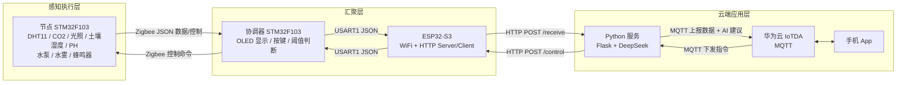

# 基于 STM32 的智慧大棚环境监测与控制系统

一套完整的智慧大棚 Demo：**传感器采集 → Zigbee 组网 → 边缘阈值控制 → 云平台 → AI 种植建议 → 手机 App 远程控制**。

STM32F103 负责采集与执行，ESP32-S3 负责联网，Python（Flask）负责数据转发与 AI 分析，华为云 IoTDA 负责与 App 双向通信。

> 演示视频：[演示视频/e0493022c455172564cf9071cb0edfcd.mp4](<演示视频/e0493022c455172564cf9071cb0edfcd.mp4>)

---

## 一、系统架构



### 数据流向

1. **节点** 周期性采集空气温湿度（DHT11）、CO₂（串口模块）、光照 / 土壤湿度 / PH（ADC + DMA），拼成 JSON 经 Zigbee 发给协调器；
2. **协调器** 解析数据、OLED 分页显示、按键切页/调阈值，并按阈值决定是否本地报警与启动执行器；
3. **协调器** 通过 USART1 把传感器 JSON 交给 **ESP32-S3**；
4. **ESP32-S3** 每 5 秒 HTTP POST 到 Python 服务 `/receive`，同时开启 HTTP Server 等待云端下发指令；
5. **Python 服务** 收到数据后立即 MQTT 上报华为云（数据突变 > 阈值或每 30 秒触发一次），后台线程调用 DeepSeek 生成种植建议后再补发一条 AI 结果；
6. **App** 通过华为云下发 `control`（水泵/水雾）、`threshold`（六项阈值）、`auto`（自动模式）指令 → Python 订阅后 HTTP 转发给 ESP32-S3 → 串口 → 协调器 → Zigbee → 节点执行。

其中 `control` 指令带 `ai_check` 标记：置 1 时先让 DeepSeek 结合当前环境判断"该不该开"，AI 返回 `allow` 才真正下发，用于防止误操作。

---

## 二、主要功能

- **多参数采集**：空气温度、空气湿度、土壤湿度、土壤 PH、光照强度、CO₂ 浓度
- **Zigbee 无线组网**：节点与协调器无线互通，无需布线
- **本地闭环控制**：阈值超限自动触发水泵 / 水雾 / 蜂鸣器报警，OLED 实时显示
- **按键交互**：协调器本地切页、查看数据、修改六项阈值、手动开关执行器
- **云端接入**：数据经华为云 IoTDA 上云，App 可远程查看与下发指令
- **AI 决策**：DeepSeek 结合传感器数据给出香瓜种植建议，并可对控制指令做安全校验
- **断线重连**：ESP32-S3 WiFi 断开后自动重连并重建 HTTP 客户端

---

## 三、仓库结构

```
.
├── 软件/
│   ├── 节点段/                    # 节点固件：传感器采集 + 执行器控制（STM32CubeMX + Keil MDK）
│   │   └── project - pro版/
│   │       ├── Core/              #   CubeMX 生成的外设初始化
│   │       ├── BSP/               #   板级驱动：DHT11 / CO2 / OLED / Zigbee / UART / delay
│   │       ├── Drivers/           #   ST HAL 库 + CMSIS
│   │       ├── MDK-ARM/           #   Keil 工程（project.uvprojx）
│   │       └── project.ioc        #   CubeMX 配置
│   ├── 协调器/                    # 协调器固件：Zigbee 汇聚 + 显示 + 按键 + ESP32 串口桥
│   │   └── project - 华为云 pro版 串口发数据给s3/
│   ├── ESP32-到py/2_LED/          # ESP32-S3 固件（ESP-IDF）：WiFi + HTTP 收发 + 串口协议解析
│   │   ├── main/main.c
│   │   └── components/            #   LED / Myuart / esp_recv / send
│   └── py/                        # Python 服务
│       ├── ai管家.py              #   完整版：MQTT + AI 校验 + 控制转发（主程序）
│       ├── 连接华为云.py          #   基础版：接收数据 + AI 分析 + 上云
│       ├── 8266连接.py            #   最小版：仅接收 + AI 分析
│       └── 111.py                 #   早期版本
├── 硬件/                          # 立创EDA专业版工程（.eprj2）：主控端 / 节点原理图 & PCB
├── 演示视频/                      # 实物演示录像
└── README.md
```

---

## 四、通信协议（串口 / Zigbee）

**节点 → 协调器**

```
{temp_value_2:26,kq_humi_value_2:61,t_ph_value:6.8,t_humi_value:45,light:73,CO2_value:512}
```

**协调器 → 节点**（控制指令）

```
{fan_state_2:0, water_state_2:1, pump_state:0, buzzer_state_2:1,}
```

**协调器 → ESP32-S3**（标准 JSON）

```json
{"CO2_value":512,"light":73,"temp_value_2":26,"kq_humi_value_2":61,"t_humi_value":45,"t_ph_value":6.8}
```

**ESP32-S3 → 协调器**（`mode` 决定解析哪一组字段）

```json
{"mode":5,"temp_max_2":35,"kq_humi_min_2":40,"t_humi_min":30,"t_ph_max":8,"light_min":50,"CO2_max":1000}
```

| 字段 | 含义 | 单位 / 范围 |
| --- | --- | --- |
| `temp_value_2` | 空气温度 | ℃ |
| `kq_humi_value_2` | 空气湿度 | %RH |
| `t_humi_value` | 土壤湿度 | % |
| `t_ph_value` | 土壤 PH | 0–14 |
| `light` | 光照强度 | % |
| `CO2_value` | CO₂ 浓度 | ppm |
| `water_state_2` | 水雾开关 | 0 关 / 1 开 |
| `pump_state` | 水泵开关 | 0 关 / 1 开 |

> 说明：STM32 之间为便于解析，发送的是**类 JSON 字符串**（key 不带引号），固件里用 `strstr` 查关键字取值；ESP32 与 Python 之间是标准 JSON。

---

## 五、硬件清单

| 类别 | 型号 / 说明 | 数量 |
| --- | --- | --- |
| 主控 | STM32F103C8T6 最小系统板 | 2（节点 + 协调器）|
| 联网 | ESP32-S3 开发板 | 1 |
| 无线 | Zigbee 透传模块（串口 AT/透传） | 2 |
| 环境 | DHT11 温湿度传感器 | 1 |
| 环境 | CO₂ 传感器（串口输出） | 1 |
| 环境 | 光敏电阻模块（ADC） | 1 |
| 环境 | 土壤湿度传感器（ADC） | 1 |
| 环境 | PH 传感器模块（ADC） | 1 |
| 交互 | 0.96" OLED（I²C/SPI） | 1 |
| 交互 | 独立按键 | 多个 |
| 执行 | 水泵、水雾/加湿模块、蜂鸣器、继电器 | 各 1 |

节点侧引脚（见 `节点段/Core/Src/main.c`）：

| 功能 | 引脚 | 备注 |
| --- | --- | --- |
| 光照 / 土壤湿度 / PH | PA0 / PA1 / PA4 | ADC1 + DMA 三通道轮询 |
| 水泵 | PB13 | 继电器输出 |
| 水雾 | PB14 | 继电器输出 |
| 蜂鸣器 | PB15 | 超限报警 |
| 风扇 | PB12 | 代码保留，未接外设 |
| Zigbee | USART2 | 与协调器通信 |

硬件设计源文件在 `硬件/`，可用**立创EDA专业版**打开查看原理图与 PCB。

---

## 六、编译与运行

### 1. STM32 节点 / 协调器

- 工具：STM32CubeMX（可选，用于改配置）+ Keil MDK-ARM 5
- 打开工程：
  - 节点：`软件/节点段/project - pro版/MDK-ARM/project.uvprojx`
  - 协调器：`软件/协调器/project - 华为云 pro版 串口发数据给s3/MDK-ARM/project.uvprojx`
- 编译 → 下载到 STM32F103C8（ST-Link / DAP-Link）

### 2. ESP32-S3 固件

```bash
cd 软件/ESP32-到py/2_LED
idf.py set-target esp32s3
idf.py build flash monitor
```

编译前先把 `components/send/send.h` 里的 `WIFI_SSID`、`WIFI_PASS`、`SERVER_URL` 改成你自己的局域网参数。

### 3. Python 服务

```bash
pip install flask paho-mqtt openai requests

# Windows
set DEEPSEEK_API_KEY=你的DeepSeek密钥
set HUAWEI_IOT_CLIENT_ID=...
set HUAWEI_IOT_USERNAME=...
set HUAWEI_IOT_PASSWORD=...
set HUAWEI_IOT_HOST=...
set ESP32_URL=http://<ESP32的IP>/control

python "软件/py/ai管家.py"
```

服务默认监听 `0.0.0.0:5000`，接口为 `POST /receive`。

### 4. 配置项

华为云设备密钥、WiFi 密码、DeepSeek Key **均不写进代码**，统一通过环境变量传入：

| 环境变量 | 说明 |
| --- | --- |
| `DEEPSEEK_API_KEY` | DeepSeek API 密钥 |
| `HUAWEI_IOT_CLIENT_ID` | 华为云 IoTDA 设备 ClientId |
| `HUAWEI_IOT_USERNAME` | 设备 Username（一般为 设备ID_设备名）|
| `HUAWEI_IOT_PASSWORD` | 设备密钥 |
| `HUAWEI_IOT_HOST` | IoTDA 接入域名 |
| `ESP32_URL` | ESP32 控制接口地址 |

---

## 七、说明与已知限制

- 本项目为课程 / 比赛 Demo 级别实现，传感器数值（光照、土壤湿度、PH）采用**经验公式标定**，量产前需重新标定。
- 风扇、天窗、补光灯的逻辑在协调器中保留，但实物未安装对应执行机构。
- 节点侧未接 OLED（`main.c` 中 `Page()` 已注释），显示集中在协调器。
- STM32 侧的"类 JSON"协议是为了在资源受限的 MCU 上省一次完整 JSON 解析，字段名改动时需同步两端固件。
- 目录名 `基于stm32智慧大鹏` 中的"大鹏"为"大棚"的笔误，仓库名使用英文 `smart-greenhouse-stm32`。
- **本仓库已在上传前移除真实的华为云设备密钥与 WiFi 密码**，仓库内为占位符 + 环境变量读取方式。

---

## 八、许可

本仓库未附带统一的开源协议；工程内 `Drivers/` 下的 STM32 HAL 库与 CMSIS 保留其原始授权声明（BSD-3-Clause / Apache-2.0）。若要正式开源，建议自行补充 `LICENSE`（如 MIT）。